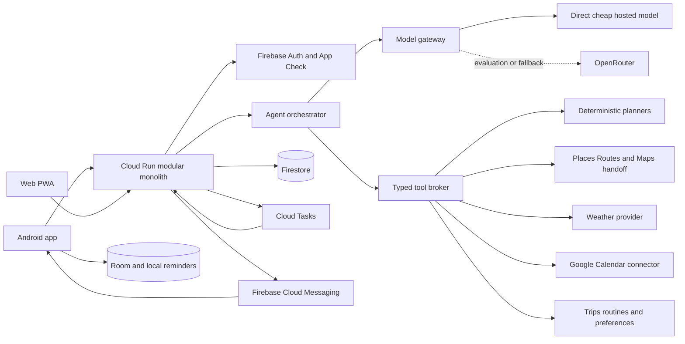

# Trip Assistant Architecture

Updated 2026-10-10. The pre-seed architecture is an Android-first product supported by a responsive web planner and one scale-to-zero Google Cloud backend.



## Deployment shape

Keep the API, worker endpoints, agent loop, planners, provider adapters, scheduler, and notification logic in one modular monolith. Cloud Run uses minimum instances zero and a low maximum during pilots. Cloud Tasks invokes private worker endpoints with OIDC. Split services only when background work measurably harms interactive latency or separate team ownership requires it.

The web client is React and TypeScript. The native client is Kotlin with Jetpack Compose, Room, DataStore, WorkManager, AlarmManager, FCM, and an Android share target. Both use generated OpenAPI contracts; the backend owns planning rules. Web IndexedDB and Android Room keep the active plan and navigation links readable offline, labelled with forecast age.

## Backend modules

```text
backend/src/trip_assistant/
  api/              auth/             permissions/
  agent/            model_gateway/    planning/
  providers/maps/   providers/weather/ providers/calendar/
  trips/            routines/         scheduler/
  notifications/    persistence/      telemetry/
```

The existing round-trip code becomes `RoundTripOptimizer` behind `PlanningProblem -> PlanningResult`. Later strategies are `SingleDayMultiStopOptimizer`, `MultiDayItineraryPlanner`, and `RoutineOccurrencePlanner`.

## Agent boundary

The model receives only tools needed for the current intent. Initial tool families are:

- place search and confirmation;
- route estimates and matrices;
- deterministic round-trip, multi-stop, and multi-day planning;
- calendar event and free/busy reads;
- weather forecasts;
- structured trip, preference, and routine reads;
- plan, reminder, routine, and calendar-change proposals;
- a separately authorized commit for side effects.

Provider content has a separate license boundary. Current Google Maps Platform terms restrict creating content from Maps content, using Maps content with text-to-speech, and specified AI uses. Until written agreement review confirms the exact design, Google route durations, ETAs, geometry, and computed recommendations do not enter model context, speech synthesis, persistent history, or training/evaluation datasets. A Google-backed route calculation is a terminal deterministic operation: the tool broker computes and the UI renders an attributed template; the model receives only success, failure, or a safe request for more user input. A different route provider may cross this boundary only after its license explicitly permits the intended LLM and voice use. See [current Maps terms](https://cloud.google.com/maps-platform/terms) and [Routes policies](https://developers.google.com/maps/documentation/routes/policies).

Every tool uses strict JSON Schema. The server injects the authenticated user ID, enforces authorization, quotas, idempotency, data minimization, and timeouts, and validates every argument. The model has no provider credentials, arbitrary HTTP, code execution, browser automation, or general connector access.

Tools are classified as **read**, **compute**, **propose**, and **commit**. A commit requires a stored pending action, an explicit user confirmation, a one-time nonce, and an idempotency key. Calendar text and provider text are treated as untrusted data and never as instructions.

Per assistant request, start with hard ceilings of six model turns, twelve tool calls, two route-optimization calls, a 20-second interactive deadline, and explicit token and dollar limits. A structured planning form remains available when the model is unavailable.

## Planning engines

The LLM never performs time arithmetic or route optimization. For a multi-stop day, the server normalizes locations, time windows, dwell durations, fixed commitments, earliest departure, latest return, optional stops, and preferences. It builds a small travel-time graph from route matrices, enumerates or uses bounded local search for the first five stops, then forward-simulates promising orders with departure-specific estimates.

For larger or multi-day plans, use Google Route Matrix data and a bounded [OR-Tools routing solver](https://developers.google.com/optimization/routing). Partition first around day boundaries, lodging, fixed events, and booked stops; optimize within each day; then validate cross-day constraints and time zones. Route Optimization API remains a future option if logistics-grade features justify its separate billing and policy constraints.

Weather annotates risk and recommended allowances. It does not secretly alter a provider ETA. The plan records provider, fetch time, traffic model, route identity where available, and every added allowance.

## Calendar and proactive operation

Google Calendar is the first connector. Request `freebusy` when availability is sufficient; prefer `calendar.events.owned.readonly` when owned calendars suffice and use `calendar.events.readonly` only when broader event access is essential. Request write permission later and separately. Store a minimal event shadow for selected calendars and a bounded planning horizon: calendar/event IDs, start/end, timezone, location or permitted place identifier, status, and update version. Do not collect descriptions, attendees, attachments, conference URLs, or invitation text.

Use Calendar push channels as change signals and incremental sync tokens to fetch changes. Renew expiring channels and run a small reconciliation job because notifications can be lost. Revocation or connector failure never blocks manual planning.

Cloud Tasks schedules morning-of checks, route refreshes, preparation reminders, departure reminders, watch renewal, and the next few routine occurrences. Each task contains only a scheduled-action ID and plan version. A stale task becomes a no-op. The backend sends FCM; Android also schedules a local reminder for the latest synced plan and suppresses duplicates by plan version.

This event-driven system is the initial meaning of “always active.” Android background limits make a continuously running app inappropriate. True hotword support is deferred until users justify building and distributing a selected Android voice-interaction service.

## Data and recovery

Use Firestore collections for users, consents, devices, saved places, trips, plan versions, execution events, routines, calendar connections, event shadows, scheduled and pending actions, model runs, quota counters, and idempotency records. Every object is keyed to the verified OpenID Connect `(issuer, sub)` identity; email is not an identity key. Firestore server libraries bypass client Security Rules, so the application and IAM enforce tenant isolation on every object, job, webhook channel, cache, device token, and memory lookup. Store structured, editable memory rather than opaque embeddings or a permanent chat transcript.

Provider outage shows the last complete plan and age. Model outage opens the deterministic form. Calendar outage uses a stale, clearly labelled shadow or manual confirmation. Cloud Tasks handlers are idempotent. Provider adapters have bounded retries, timeouts, circuit breakers, and hard quotas. Never combine legs from different providers inside one supposedly comparable plan.

## Cost controls

The main variable cost will usually be Maps, especially route-matrix elements and proactive refreshes. Each plan records model tokens/cost, Routes calls/elements, Places calls, Weather calls, and latency. Enforce per-user daily quotas, per-plan provider ceilings, minimal response field masks, short in-request memoization, model token caps, and provider kill switches. Do not create one Cloud Scheduler job per user; use Cloud Tasks for occurrences and one small reconciliation schedule.

Relevant official references: [Routes](https://developers.google.com/maps/documentation/routes), [waypoint optimization](https://developers.google.com/maps/documentation/routes/opt-way), [Maps URLs](https://developers.google.com/maps/documentation/urls/get-started), [Calendar scopes](https://developers.google.com/workspace/calendar/api/auth), [Calendar push notifications](https://developers.google.com/workspace/calendar/api/guides/push), [Calendar incremental sync](https://developers.google.com/workspace/calendar/api/guides/sync), [Cloud Tasks pricing](https://cloud.google.com/tasks/pricing), [FCM architecture](https://firebase.google.com/docs/cloud-messaging/fcm-architecture), and [Android background limits](https://developer.android.com/about/versions/oreo/background.html).


