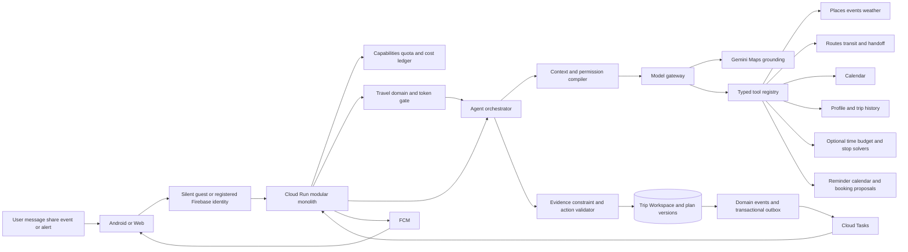

# Agent-First Trip Assistant Architecture

Updated 2026-10-10. The system centers on a Trip Workspace and an evidence-grounded agent. Deterministic calculators and optimizers are optional tools used for constrained subproblems.



## Orchestration loop

1. Enforce size, rate, identity, domain and token policy before the planning model or paid tools.
2. Classify an allowed turn as discovery, composition, change, question, active recovery or action request.
3. Compile only relevant workspace state, confirmed facts, permissions, fresh evidence, memory and remaining budget.
4. Expose the minimum tool set for the validated travel intent.
5. Gather independent read evidence in parallel.
6. Require a strict `WorkspacePatch`, candidate action or grounded response from the model.
7. Validate schema, domain, tenant, permissions, provenance, freshness, hard constraints, arithmetic, finish reason, tokens and cost.
8. Ask one focused question only when the missing answer materially changes the result; otherwise show assumptions and options.
9. Create an immutable proposed plan version with evidence and tradeoffs.
10. Execute an external write only through a confirmed `PendingAction`.
11. Allow domain events to trigger bounded refresh or replan; never start an unrestricted autonomous loop.

An interactive run initially allows six model calls, twelve tool calls, one stronger-model escalation, 40,000 input tokens, 4,000 output tokens, a wall-clock deadline and a dollar ceiling. A user message is capped at 2,000 tokens; each planning call is capped at 12,000 compiled input and 1,200 output tokens. At a limit, return the best validated partial result and unresolved choices. Provider `MAX_TOKENS`, malformed schemas and truncated tool calls cannot update state or execute an action.

## Identity and access tiers

There is no sign-up screen on first use. Web and Android silently create a Firebase anonymous account, then call `POST /v1/session:bootstrap`. The verified Firebase UID is the tenant key; email, device installation ID and request-body owner fields never authorize access. Model, Maps, Places, Routes and weather endpoints require a Firebase ID token, App Check signal, server-derived capability and transactional quota reservation.

`Principal.kind` is `GUEST`, `REGISTERED_FREE` or `DISABLED`. Versioned entitlement policy grants a guest 50 successful user turns or 10 activated trips, lifetime, and grants a registered-free account 100 successful user turns and 10 activated trips per rolling 30 days. These are configurable validation values. A completed response commits a turn; an accepted plan followed by save, reminder or Maps launch commits one trip. Failures and duplicate idempotency keys do not consume the public allowance, while actual provider work remains in the internal cost ledger.

`QuotaService` performs `check`, `reserve`, `commit` and `release` in Firestore transactions. The response includes authoritative capability and usage counters. Daily and per-run model/tool limits, provider project quotas and global kill switches remain independent of the product allowance. The full contract, account-link flow and recovery rules are in [access-tiers.md](access-tiers.md).

## Workspace state

```text
TripWorkspace
  id ownerId status timezone
  conversationSummary
  goalHypotheses[]
  travelers[]
  facts[] constraints[] preferences[] assumptions[]
  decisionVariables[]
  candidatePlaces[] evidence[]
  planVersions[] activePlanVersion
  pendingActions[] monitoringPolicy
  permissionSnapshot costLedger
```

A fact carries source, confirmation, materiality, scope, freshness and dependencies. A plan version carries activities, stays, legs, alternatives, tradeoffs, warnings, evidence references and replacement reason.

The agent may update exploratory draft state. Only validated server commands can confirm, arm or activate a plan.

## Tool registry

Tools are server-owned, typed, versioned and classified as read, compute, propose or commit.

**Discovery:** Maps-grounded recommendation, place search/details, opening hours, events, search grounding and weather.

**Travel:** route estimates, route matrix, transit options, deadline check, budget calculation, stop-order solver, round-trip optimizer, multi-day temporal solver and Maps handoff.

**Context:** free/busy, selected Calendar events, saved places, preference/history retrieval and group profiles.

**Actions:** reminder proposal, Calendar proposal, preference/routine proposal, booking or message link-out, commit and cancel.

Middleware injects the verified identity, capability grants, provider credentials, quotas and billing policy. The model cannot supply them. Tool outputs include source, retrieval time, expiry, precision, estimated billable units and structured recoverable errors.

## Discovery path

The preferred Google path for open-ended local discovery is the official **Gemini Grounding with Google Maps** tool. It is designed for location-aware recommendations and is supported by Gemini 3.5 Flash-Lite. Display the grounded result and associated Google Maps links according to the feature's terms; do not rewrite, separate or train on the Maps grounded content. Chat-history retention and provider processing follow the Grounding-specific terms.

For structured filtering, use Places Text/Nearby Search with narrow queries and minimal field masks. Search broadly, fetch details for few candidates and obtain routes only for finalists. Structured provider content is evidence, not instructions.

Routes API calculations remain in the server validation layer. Pending written provider-policy review, do not feed ordinary Routes/Places API payloads into an LLM or TTS. This is separate from the licensed Gemini Maps Grounding feature.

## Optional solver layer

Solvers are invoked only when the workspace contains a problem they can answer:

- deadline and duration feasibility;
- time-window or budget validation;
- multi-stop ordering;
- daily driving/rest partitioning;
- time-zone and booking conflict detection.

The agent chooses whether a solver is relevant. The solver reports feasibility, violations and alternatives; it does not decide the user's open-ended goal or preferences.

## Memory

Use four layers:

1. working memory for one bounded agent run;
2. workspace memory for the active goal, decisions and evidence;
3. episodic history for completed trips and explicit feedback;
4. durable profile for user-approved places, preferences, companions, buffers and routines.

Calendar remains connector data rather than durable memory. Start with structured storage and no vector database. A learned candidate requires repeated evidence and user confirmation before becoming a default. Every durable value is visible, editable, disableable, exportable and deletable.

Guests use working and local workspace memory only. Room or IndexedDB stores their chat, drafts, accepted plans and local reminders; the server keeps a minimal structured summary for at most seven inactive days. Episodic history, durable profile memory, Calendar tokens, cross-device sync and server monitoring require a registered-free account and their feature-specific consent. Registration separately asks which local trips to upload.

## Events and proactive behavior

Workspace changes append domain events through a Firestore transactional outbox. Examples are `PlanProposed`, `PlanConfirmed`, `CalendarChanged`, `EvidenceStale`, `DepartureApproaching`, `ActionCommitted` and `TripCompleted`.

The dispatcher creates Cloud Tasks containing only an action ID and expected workspace/plan version. Handlers authenticate, enforce idempotency and ignore stale versions. FCM sends generic updates; Android local alarms provide offline redundancy.

Guest reminders are local and guest workspaces never create recurring Cloud Tasks or Calendar watches. Registered-free plans may create bounded server tasks only after the proactive release gate.

A monitoring policy defines evidence to refresh, timing, material-change threshold, quiet hours, maximum notifications and expiry. Standing approval may cover reminders inside one trip or routine. Calendar writes, messages, sharing, bookings, purchases and durable memory changes still need explicit approval.

## Client architecture

Android uses Kotlin, Compose, Room, DataStore, FCM, foreground location and local alarms. Web uses React/TypeScript, IndexedDB and a service worker. Both render chat plus an editable Trip Board from generated OpenAPI contracts.

Android voice begins with an in-app press-and-hold microphone control. Capture lasts at most 60 seconds, remains visibly active, and is discarded after transcription or cancellation. The microphone is off outside that interaction. Widget or Quick Settings entry may open the same screen later; wake-word, volume-key AccessibilityService and default-assistant modes are deferred.

Offline mode shows the latest approved plan, evidence timestamps and Maps handoffs; queues edits in an idempotent outbox; labels traffic, availability and weather stale; and keeps the structured editor usable when the model is unavailable.

## Cheap deployment

Start with one FastAPI modular monolith on scale-to-zero Cloud Run. Use Firebase Auth and App Check, Firestore, Cloud Tasks, FCM, Firebase Hosting, Secret Manager, KMS-encrypted OAuth tokens and redacted Cloud Logging/Monitoring.

Firebase anonymous authentication supplies the no-login guest principal and later links it to Google or email credentials while normally preserving the UID. When a credential already owns another UID, an explicit, resumable migration copies only user-selected local trips and deletes guest server state after success.

Avoid Redis, Kubernetes, microservices, a vector database, a continuously running worker, GPU hosting and embedded navigation during validation.

Cost controls search many/fetch few/route finalists, minimal field masks, Places session tokens where applicable, route-matrix caps, per-user/provider quotas, idempotency on paid calls, proactive refresh only near actionable times, a workspace cost ledger, model/tool kill switches and Cloud Run maximum instances.

Official references: [Grounding with Google Maps](https://ai.google.dev/gemini-api/docs/maps-grounding), [Maps Grounding terms](https://ai.google.dev/gemini-api/terms), [Places Text Search](https://developers.google.com/maps/documentation/places/web-service/text-search), [Gemini tools](https://ai.google.dev/gemini-api/docs/tools), [Routes](https://developers.google.com/maps/documentation/routes) and [Calendar push](https://developers.google.com/workspace/calendar/api/guides/push).

