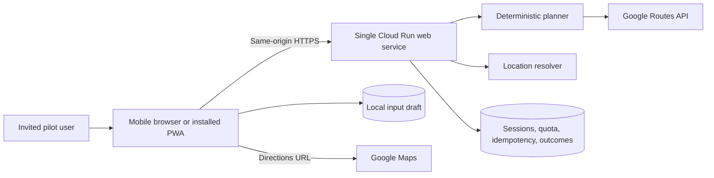
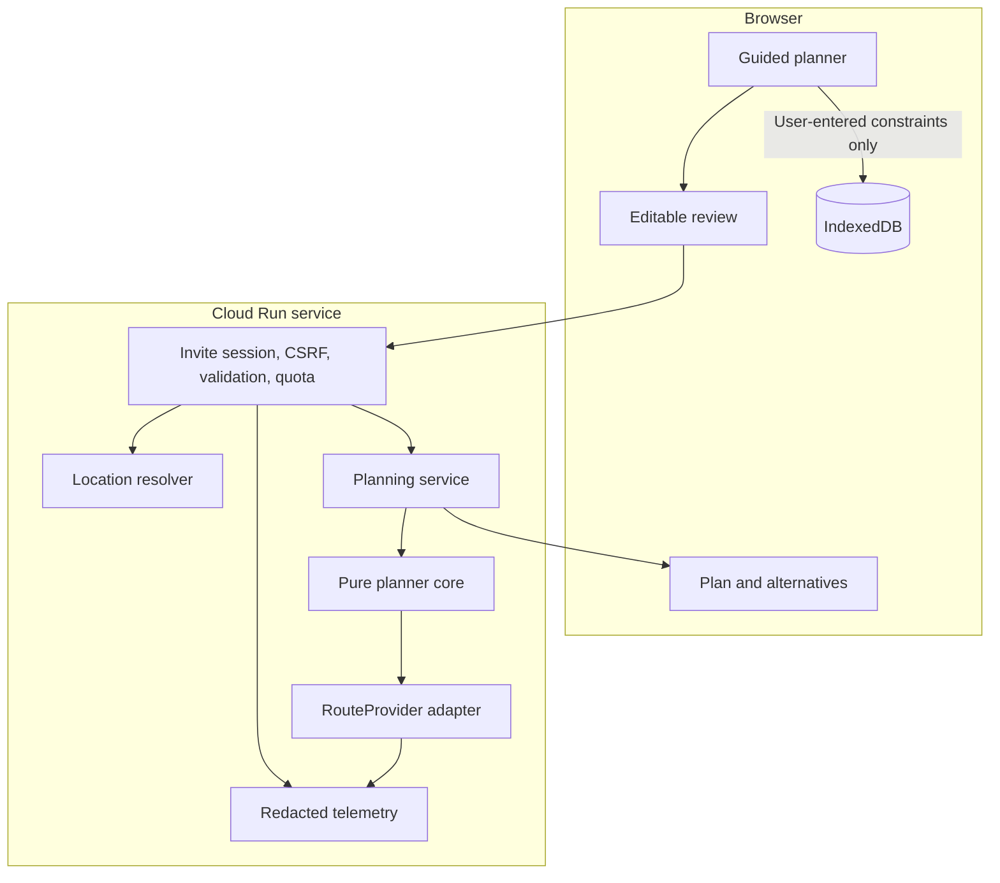

# Web-first system architecture

Status: target architecture for the pre-seed pilot. Nothing in this document is deployed yet.

## Design decision

Use one mobile-first web codebase and one scale-to-zero service:

- **React + TypeScript + Vite** for the responsive client;
- **Python 3.12 + FastAPI + Pydantic** for the API and deterministic planner;
- one Docker image that serves both the compiled frontend and `/api/v1` from the same origin;
- **Cloud Run request-based billing**, minimum instances `0`, maximum instances `1` for the private pilot;
- **Firestore only for invite sessions, atomic quota/idempotency state, and structured pilot outcomes**;
- browser IndexedDB for user-entered drafts and permitted location identifiers, never provider-derived route results;
- Google Routes behind a server-only provider adapter;
- Google Maps URLs for navigation.

This design avoids a second hosting platform, CORS complexity, a public routing key, a native app, a custom domain, a paid database, and a background worker. Cloud Run can scale to zero and currently includes a monthly free tier; Firestore also has a no-cost quota. Actual invoices must still be checked because Maps calls, builds, image storage, egress, and usage beyond free quotas can incur charges. See [Cloud Run pricing](https://cloud.google.com/run/pricing) and [Firestore pricing](https://firebase.google.com/docs/firestore/pricing).

## Context



The server never stores a user's trip history. It processes precise locations and provider-derived route results in memory and emits only redacted operational metrics. IndexedDB keeps the user's own constraints, input strings, and permitted identifiers, scoped to the current pilot session. Route durations, arrival times, candidates, geometry, and recommendations are not persisted unless a later provider-policy review explicitly permits a documented TTL. Reloading restores inputs and requires a new calculation. Google-derived results display the required attribution, and public `/privacy` and `/terms` pages describe Google processing. See the [Routes policies](https://developers.google.com/maps/documentation/routes/policies) and [Places policies](https://developers.google.com/maps/documentation/places/web-service/policies).

## Repository target

```text
web/
  src/
    app/                       # Router, providers and global error boundary
    features/
      planner/                 # Guided form, review, loading and result
      locations/               # Manual/current location confirmation
      active-plan/             # Refresh, leaving-now and Maps handoff
      pilot-feedback/
    components/
    domain/                    # Generated API types and view models
    storage/                   # IndexedDB and migration code
    analytics/                 # Allowlisted, location-free events
    pwa/                       # Manifest/service worker added after core flow
  tests/

backend/
  pyproject.toml
  src/when_shouldgo/
    api/v1/                    # Session, locations, plans and outcomes
    api/middleware/            # Session, CSRF, rate limit and idempotency
    domain/                    # Strict request/result/error models
    planner/                   # Pure round-trip search and scoring
    providers/                 # Protocol, Google adapter and fake provider
    persistence/               # Firestore session/quota/idempotency/outcomes only
    telemetry/                 # Redacted metrics and structured logs
    static/                    # Compiled web assets copied during build
  tests/
    unit/
    contract/
    integration/

contracts/
  openapi.yaml
  examples/

experiments/
  arrival_deadline/            # Existing work preserved as historical evidence

infra/
  cloud-run-service.yaml
  bootstrap.ps1
  verify-infra.ps1
  deploy.ps1

docs/
```

The current `tools/` experiment moves only after its existing tests and derived results are frozen. Production code must never import it.

## Request boundaries



All precise address/coordinate inputs are sensitive. They may appear in the TLS request body and transient process memory, but never in this application's URLs or history, application logs, analytics, trace attributes, Firestore quota documents, or error reports. A user-triggered Google Maps handoff necessarily sends the selected endpoints to Google and may add them to browser or Maps history. The handoff uses a fixed HTTPS Maps host, `URLSearchParams`, `noopener`, `noreferrer`, and `Referrer-Policy: no-referrer`.

## Pilot access and sessions

The private pilot does not need a full account system.

1. Each tester receives a high-entropy single-use invite code outside the app.
2. `POST /api/v1/session:exchange` atomically consumes the invite after a timing-safe keyed-hash comparison, creates an opaque random session, and returns a `__Host-` cookie with `Secure`, `HttpOnly`, `SameSite=Strict`, and `Path=/`.
3. Firestore stores the tester pseudonym, session hash, expiry, consent version, atomic quota/idempotency state, and optional structured outcomes.
4. State-changing requests also require a CSRF token bound to the session.
5. Logging out or pilot removal invalidates the server session. Local records are bound to a non-secret session owner handle and are cleared on logout, session replacement, owner mismatch, pilot-data deletion, or no later than 24 hours after `homeBy`.

The cookie cannot outlive the server session. The service validates the exact canonical host and Origin, disables CORS, throttles invite exchange before authentication, derives every Firestore owner from the session, and exposes no Firestore web-client access. Invite issuance/revocation remains an IAM-controlled operator action.

Do not put invite codes, sessions, addresses, or coordinates in query strings. Follow [OWASP session guidance](https://cheatsheetseries.owasp.org/cheatsheets/Session_Management_Cheat_Sheet.html).

## Planning model

For a candidate home-door departure `t`:

```text
readyAt              = earliestPreparationStart + preparationDuration
routeOutDepart       = t + originDoorToCar
outbound             = provider(origin, destination, routeOutDepart)
visitStart           = routeOutDepart + outbound.duration + destinationParkingToDoor
visitEnd             = visitStart + visitDuration
routeBackDepart      = visitEnd + destinationDoorToCar
return               = provider(destination, origin, routeBackDepart)
homeArrival          = routeBackDepart + return.duration + homeParkingToDoor
safeHomeDeadline     = homeBy - safetyCushion
roadTime             = outbound.duration + return.duration
startPreparingAt     = t - preparationDuration
```

A candidate is feasible only when `t >= readyAt`, `homeArrival <= safeHomeDeadline`, the complete visit fits any supplied visit window, and both legs returned valid estimates under the same provider/model/preferences.

Rank by exact provider seconds of total road time, then later departure only when the exact score is equal, then timestamp. Round only for display. Label the winner **best evaluated**.

Traffic is nonmonotonic and the second leg depends on the first, so the search uses global anchors plus refinement around minima, feasibility boundaries, and large gaps. It never uses binary search.

Pilot budgets:

- maximum 12 candidate chains and 24 paid route estimates for a normal plan, including a reserved leave-when-ready baseline;
- maximum four concurrent provider calls across the service, not per request;
- four-second per-call timeout and 15-second overall timeout;
- at most one retry for timeout, 429, or 5xx when the same hard budget permits;
- every retry counts;
- return `SEARCH_INCOMPLETE` only when a required baseline/finalist sample fails or the fixed search schedule cannot finish before the call or time cap.

Stage 0 freezes the deterministic sampling/refinement schedule and its required samples. A successful response claims only the best evaluated candidate; it never claims that an unsampled interval cannot contain a better time.

The algorithm may use up to 32 estimates only in controlled evaluation to establish whether a 24-estimate production budget can meet the quality gate. If it cannot, the pilot stops until the provider, objective, or search changes.

## Provider interface

```text
RouteProvider
  capabilities() -> ProviderCapabilities
  estimate(RouteEstimateRequest) -> RouteEstimate

RouteEstimateRequest
  requestId, origin, destination, departureInstant,
  travelMode, routePolicy, trafficModel

RouteEstimate
  provider, requestedDeparture, effectiveDeparture,
  duration, arrival, distance, asOf, fallbackUsed,
  latencyMs, billableUnits, warnings
```

Validate positive finite durations, plausible bounds, timestamps, request correlation, expected travel mode, and fallback state. Use one provider and route policy per plan. Do not combine Google and TomTom durations.

Use the official Google Routes client library with a dedicated least-privilege Cloud Run service identity and Application Default Credentials/OAuth for the pilot. No service-account key file is allowed. If that path fails the bounded live smoke test, an API key requires a documented architecture/cost decision for static egress plus server IP and API restrictions; it is never placed in JavaScript or the browser network path. Invite and token-signing secrets live in Secret Manager under separate build/runtime permissions. See [Routes client libraries](https://developers.google.com/maps/documentation/routes/client-libraries), [Cloud Run service identity](https://docs.cloud.google.com/run/docs/securing/service-identity), and [Maps API security](https://developers.google.com/maps/api-security-best-practices).

## HTTP API

All responses include `schemaVersion`, `requestId`, and a stable result or error code.

### Session

- `POST /api/v1/session:exchange`
- `DELETE /api/v1/session`

### Location confirmation

- `POST /api/v1/locations:resolve`

Accept a manually entered address or browser coordinate. Return at most five display candidates and encrypted or server-referenced short-lived confirmation tokens. Tokens are bound to session, purpose, schema version, and expiry. The user confirms both endpoints before any optimization. Server-side resolution avoids exposing a geocoding credential.

### Compute and refresh

- `POST /api/v1/round-trip-plans:compute`
- `POST /api/v1/round-trip-plans:refresh`
- `POST /api/v1/round-trip-plans:leaving-now`

Required headers include the session cookie, custom CSRF header, and `Idempotency-Key`. Refresh and leaving-now requests use purpose-specific, session-bound, expiring constraint tokens so the server does not need permanent trip storage. Every operation consumes its documented quota; leaving-now is one bounded route estimate.

Before provider access, a Firestore transaction atomically reserves the worst-case billable units and creates a session-bound idempotency lease from an HMAC of the key, canonical request hash, operation, and schema version. States are `IN_PROGRESS`, `COMPLETED`, and `FAILED`; duplicates receive `PENDING`, `ALREADY_COMPUTED`, or a payload-mismatch error and make zero provider calls. The server does not persist a replayable route result, so the client keeps the successful response in memory; a crash conservatively spends the reservation. Provider calls never occur inside a retried Firestore transaction. This is duplicate suppression and bounded spending, not a promise to replay a lost response.

Statuses:

- `FEASIBLE`
- `NO_FEASIBLE_PLAN`
- `LOCATION_CONFIRMATION_REQUIRED`
- `PROVIDER_UNAVAILABLE`
- `SEARCH_INCOMPLETE`
- `QUOTA_EXCEEDED`
- `VALIDATION_ERROR`

The success response contains the schedule, two alternatives, calculation/freshness times, warnings, and search evidence: provider, traffic model, candidate count, provider-call count, cap state, and `BEST_EVALUATED` meaning.

### Pilot outcome

- `POST /api/v1/pilot-outcomes`
- `DELETE /api/v1/pilot-data`

Accept only enumerated reason/adherence/deadline/reuse fields plus rounded durations and forecast-error offsets. Reject free text, absolute trip timestamps, locations, GPS traces, uploads, and unknown fields. The authenticated session determines ownership. Deletion synchronously revokes the session and deletes its structured outcomes, quota, consent, and idempotency records; the browser separately clears local inputs. Firestore TTL is cleanup, not an authorization or immediate-deletion mechanism.

## Compute sequence

```mermaid
sequenceDiagram
    participant U as User
    participant W as Web app
    participant A as Same-origin API
    participant P as Planner
    participant R as Route provider
    participant M as Google Maps

    U->>W: Enter and confirm all constraints
    W->>A: Session + CSRF + idempotent compute request
    A->>A: Validate and atomically reserve quota/idempotency lease
    A->>P: Typed planning problem
    loop Bounded candidate departures
        P->>R: Outbound estimate
        R-->>P: Duration or typed failure
        P->>R: Return estimate at derived time
        R-->>P: Duration or typed failure
    end
    P-->>A: Ranked candidates or explicit no-plan
    A-->>W: Versioned result and evidence
    W->>W: Keep result in memory; save user-entered inputs only
    U->>W: Open outbound or return navigation
    W->>M: Universal Maps URL
```

## Browser behavior

- Use a responsive single-column flow at phone widths and a form/summary split on larger screens.
- Store versioned user-entered constraints, original input strings, and permitted location identifiers in IndexedDB. Do not persist provider-derived route content or use query strings for trip data.
- On reload, restore inputs and require a new calculation. If the tab remains loaded while offline, the in-memory result is visibly stale; reloading offline is not supported until the PWA stage.
- Bind local data to the bootstrapped session owner handle, purge it on logout/session change/deletion, and expire it no later than 24 hours after `homeBy`. Fall back to memory with a visible **Not saved on this device** state when IndexedDB is unavailable or corrupt.
- Mark API responses `Cache-Control: no-store` and keep `/api/` outside every future service-worker cache.
- Geolocation is requested only after a user action and has a manual fallback.
- Maps URL construction occurs only after an explicit user action, is excluded from telemetry, and opens in a new tab/app context; Google may select a different live route.
- The service worker, when added, caches only versioned static assets and an offline shell. It never caches API requests, precise locations, or route results.
- A PWA manifest enables installation where supported; installation is not required for planning.

## Cheap deployment profile

Pilot configuration:

```text
Cloud Run region: northamerica-northeast2 (Toronto)
Billing mode: request-based
Minimum instances: 0
Maximum instances: 1
Container concurrency: 8
Memory: 512 MiB
CPU: 1
Request timeout: 20 seconds
Custom domain/load balancer: none
Background worker/scheduler: none
Database: one Firestore database within free quota
```

Cloud Run scales to zero by default and supports a maximum-instance limit for cost control, but Google documents that the configured maximum can be exceeded briefly. Firestore transactions therefore enforce quotas across independent workers; `max=1` only reduces exposure. A custom domain, load balancer, paid Redis, always-on instance, managed SQL database, and multi-region deployment are deferred. References: [Cloud Run autoscaling](https://docs.cloud.google.com/run/docs/about-instance-autoscaling) and [maximum instances](https://docs.cloud.google.com/run/docs/configuring/max-instances).

Use one dedicated pilot Google Cloud project. A versioned `bootstrap.ps1` creates or records enabled APIs, IAM, Firestore location/indexes/TTL, Artifact Registry, Maps quotas, Secret Manager bindings, billing alerts, and log settings; `verify-infra.ps1` checks every automated and manual setting. Build once from a clean commit with locked dependencies and a pinned base image, push the image, and deploy `IMAGE@sha256:...` to a no-traffic tagged revision before promotion. `gcloud run deploy --source` is not a release path. Explicit `.gcloudignore` and `.dockerignore` files and upload/image-layer scans exclude local secrets and trip artifacts. Retain the five newest images and tagged stable/rollback images; delete older untagged builds after 30 days. Terraform and a paid staging project remain deferred.

## Cost controls

Hosting is expected to remain near zero at pilot volume, but it is not guaranteed to be free. Routing is the dominant marginal cost.

- hard server cap: 24 route estimates per plan;
- whole-pilot Routes reservation cap: 1,200 billable units, including 240 reserved for smoke/recovery work;
- Maps project daily quota: 650 Routes units;
- paid location-resolution cap: 100 calls, tracked separately;
- per-session cap: 3 full plans/day and 10/week during pilot;
- project Maps daily quota sized to the invited cohort;
- Cloud Run maximum instances `1`;
- provider kill switch that returns a friendly maintenance state before making a call;
- record billable units and pricing-table version per plan;
- reconcile estimates with the actual billing export after the first 5, 10, and 20 plans;
- configure billing alerts and an eligible spend cap when available.

The service exposes a no-dependency `/healthz` endpoint that never calls Maps or Firestore. Passive request/error monitoring and a manual smoke test before each assisted session preserve scale-to-zero behavior; no periodic uptime check is required.

Twenty pilot plans with one full refresh each would use at most about 960 route estimates at the hard cap, before lightweight live checks. That is below Google's currently documented 5,000 monthly free event cap for the relevant pricing table, assuming the same billing account has no competing usage. This is a planning estimate, not a promise of a zero invoice. [Google Maps pricing](https://developers.google.com/maps/billing-and-pricing/pricing).

Cloud Billing warns that alerts-only budgets do not stop usage. Quotas, the server kill switch, maximum instances, and any eligible spend cap provide the actual enforcement layers. See [budget alerts](https://docs.cloud.google.com/billing/docs/how-to/budgets) and [spend caps](https://docs.cloud.google.com/billing/docs/how-to/budgets-spend-caps).

## Migration and expansion

1. Freeze and move the historical one-way experiment.
2. Create the pure planner, fake provider, and dense-oracle tests.
3. Add the versioned API and Google adapter with a local fake mode.
4. Build the responsive web vertical slice and local input persistence.
5. Deploy the invite-only Cloud Run pilot and enforce quotas/kill switch.
6. Run the assisted pilot and reconcile accuracy, adoption, latency, and cost.
7. Add PWA installability only after the basic journey is stable.
8. Build Android later by reusing `contracts/openapi.yaml` if native capabilities are justified by measured demand.

Verification, security, operations, incident response, and release gates are in [web-quality-operations.md](web-quality-operations.md).

