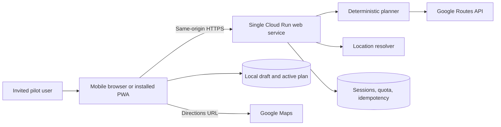
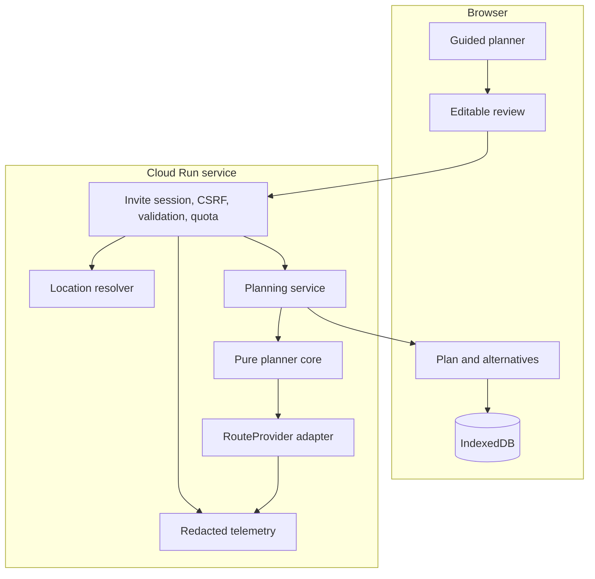
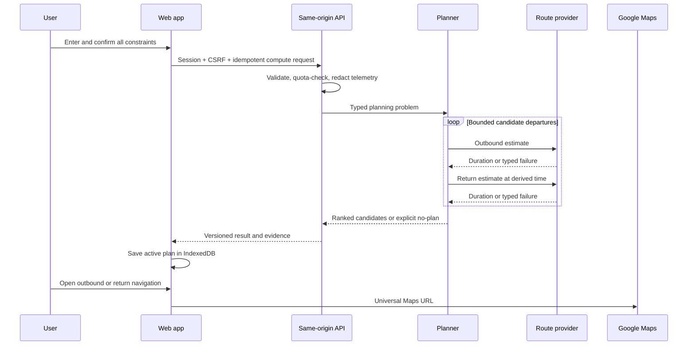

# Web-first system architecture

Status: target architecture for the pre-seed pilot. Nothing in this document is deployed yet.

## Design decision

Use one mobile-first web codebase and one scale-to-zero service:

- **React + TypeScript + Vite** for the responsive client;
- **Python 3.12 + FastAPI + Pydantic** for the API and deterministic planner;
- one Docker image that serves both the compiled frontend and `/api/v1` from the same origin;
- **Cloud Run request-based billing**, minimum instances `0`, maximum instances `1` for the private pilot;
- **Firestore only for invite sessions, quotas, and short-lived idempotency metadata**;
- browser IndexedDB for drafts and the active plan;
- Google Routes behind a server-only provider adapter;
- Google Maps URLs for navigation.

This design avoids a second hosting platform, CORS complexity, a public routing key, a native app, a custom domain, a paid database, and a background worker. Cloud Run can scale to zero and currently includes a monthly free tier; Firestore also has a no-cost quota. Actual invoices must still be checked because Maps calls, builds, image storage, egress, and usage beyond free quotas can incur charges. See [Cloud Run pricing](https://cloud.google.com/run/pricing) and [Firestore pricing](https://firebase.google.com/docs/firestore/pricing).

## Context



The server never stores a user's trip history. The browser keeps the active plan locally. The server processes precise locations in memory for routing and emits only redacted operational metrics.

## Repository target

```text
web/
  src/
    app/                       # Router, providers and global error boundary
    features/
      planner/                 # Guided form, review, loading and result
      locations/               # Manual/current location confirmation
      active-plan/             # Refresh, leaving-now and Maps handoff
      pilot-feedback/
    components/
    domain/                    # Generated API types and view models
    storage/                   # IndexedDB and migration code
    analytics/                 # Allowlisted, location-free events
    pwa/                       # Manifest/service worker added after core flow
  tests/

backend/
  pyproject.toml
  src/when_shouldgo/
    api/v1/                    # Session, locations, plans and outcomes
    api/middleware/            # Session, CSRF, rate limit and idempotency
    domain/                    # Strict request/result/error models
    planner/                   # Pure round-trip search and scoring
    providers/                 # Protocol, Google adapter and fake provider
    persistence/               # Firestore session/quota/idempotency only
    telemetry/                 # Redacted metrics and structured logs
    static/                    # Compiled web assets copied during build
  tests/
    unit/
    contract/
    integration/

contracts/
  openapi.yaml
  examples/

experiments/
  arrival_deadline/            # Existing work preserved as historical evidence

infra/
  cloud-run-service.yaml
  deploy.ps1

docs/
```

The current `tools/` experiment moves only after its existing tests and derived results are frozen. Production code must never import it.

## Request boundaries



All precise address/coordinate inputs are sensitive. They may appear in the TLS request body and transient process memory, but never in application logs, analytics, trace attributes, Firestore quota documents, URLs, or error reports.

## Pilot access and sessions

The private pilot does not need a full account system.

1. Each tester receives a high-entropy single-use invite code outside the app.
2. `POST /api/v1/session:exchange` compares a keyed hash, creates an opaque random session, and returns a `__Host-` cookie with `Secure`, `HttpOnly`, `SameSite=Strict`, and `Path=/`.
3. Firestore stores only the tester pseudonym, session hash, expiry, quota counters, and consent version.
4. State-changing requests also require a CSRF token bound to the session.
5. Logging out or pilot removal invalidates the server session. Local plan deletion is a separate visible action.

Do not put invite codes, sessions, addresses, or coordinates in query strings. Follow [OWASP session guidance](https://cheatsheetseries.owasp.org/cheatsheets/Session_Management_Cheat_Sheet.html).

## Planning model

For a candidate home-door departure `t`:

```text
readyAt              = earliestPreparationStart + preparationDuration
routeOutDepart       = t + originDoorToCar
outbound             = provider(origin, destination, routeOutDepart)
visitStart           = routeOutDepart + outbound.duration + destinationParkingToDoor
visitEnd             = visitStart + visitDuration
routeBackDepart      = visitEnd + destinationDoorToCar
return               = provider(destination, origin, routeBackDepart)
homeArrival          = routeBackDepart + return.duration + homeParkingToDoor
safeHomeDeadline     = homeBy - safetyCushion
roadTime             = outbound.duration + return.duration
startPreparingAt     = t - preparationDuration
```

A candidate is feasible only when `t >= readyAt`, `homeArrival <= safeHomeDeadline`, the complete visit fits any supplied visit window, and both legs returned valid estimates under the same provider/model/preferences.

Rank by rounded whole-minute road time, later departure within an equal whole-minute score, then timestamp. Label the winner **best evaluated**.

Traffic is nonmonotonic and the second leg depends on the first, so the search uses global anchors plus refinement around minima, feasibility boundaries, and large gaps. It never uses binary search.

Pilot budgets:

- maximum 12 candidates and 24 paid route estimates for a normal plan;
- maximum four concurrent provider calls;
- four-second per-call timeout and 15-second overall timeout;
- at most one retry for timeout, 429, or 5xx when the same hard budget permits;
- every retry counts;
- return `SEARCH_INCOMPLETE` if missing estimates or unsampled gaps make the result unreliable.

The algorithm may use up to 32 estimates only in controlled evaluation to establish whether a 24-estimate production budget can meet the quality gate. If it cannot, the pilot stops until the provider, objective, or search changes.

## Provider interface

```text
RouteProvider
  capabilities() -> ProviderCapabilities
  estimate(RouteEstimateRequest) -> RouteEstimate

RouteEstimateRequest
  requestId, origin, destination, departureInstant,
  travelMode, routePolicy, trafficModel

RouteEstimate
  provider, requestedDeparture, effectiveDeparture,
  duration, arrival, distance, asOf, fallbackUsed,
  latencyMs, billableUnits, warnings
```

Validate positive finite durations, plausible bounds, timestamps, request correlation, expected travel mode, and fallback state. Use one provider and route policy per plan. Do not combine Google and TomTom durations.

Prefer the official Google Routes client library with Cloud Run Application Default Credentials/OAuth when supported; its documentation describes ADC for client libraries. If an API key is used, store it outside source, restrict it to Routes API, rotate it, and monitor it. Never place it in JavaScript or the browser network path. See [Routes client libraries](https://developers.google.com/maps/documentation/routes/client-libraries) and [Maps API security](https://developers.google.com/maps/api-security-best-practices).

## HTTP API

All responses include `schemaVersion`, `requestId`, and a stable result or error code.

### Session

- `POST /api/v1/session:exchange`
- `DELETE /api/v1/session`

### Location confirmation

- `POST /api/v1/locations:resolve`

Accept a manually entered address or browser coordinate. Return at most five display candidates and opaque short-lived confirmation tokens. The user confirms both endpoints before any optimization. Server-side resolution avoids exposing a geocoding credential.

### Compute and refresh

- `POST /api/v1/round-trip-plans:compute`
- `POST /api/v1/round-trip-plans:refresh`

Required headers include the session cookie, CSRF token, and `Idempotency-Key`. A refresh resubmits a signed short-lived constraint token so the server does not need permanent trip storage.

Statuses:

- `FEASIBLE`
- `NO_FEASIBLE_PLAN`
- `LOCATION_CONFIRMATION_REQUIRED`
- `PROVIDER_UNAVAILABLE`
- `SEARCH_INCOMPLETE`
- `QUOTA_EXCEEDED`
- `VALIDATION_ERROR`

The success response contains the schedule, two alternatives, calculation/freshness times, warnings, and search evidence: provider, traffic model, candidate count, provider-call count, cap state, and `BEST_EVALUATED` meaning.

### Pilot outcome

- `POST /api/v1/pilot-outcomes`

Accept only voluntary timestamps/durations, adherence bucket, deadline outcome, reuse intent, and free-text feedback after an explicit warning not to enter addresses. Exact endpoints and GPS traces are not accepted.

## Compute sequence



## Browser behavior

- Use a responsive single-column flow at phone widths and a form/summary split on larger screens.
- Store drafts, confirmed inputs, active result, and schema version in IndexedDB. Do not use query strings for trip data.
- On reload, restore the plan and mark it stale according to the freshness policy.
- Geolocation is requested only after a user action and has a manual fallback.
- Maps opens in a new tab/app context and may select a different live route.
- The service worker, when added, caches only versioned static assets and an offline shell. It never caches API requests, precise locations, or route results.
- A PWA manifest enables installation where supported; installation is not required for planning.

## Cheap deployment profile

Pilot configuration:

```text
Cloud Run region: northamerica-northeast2 (Toronto)
Billing mode: request-based
Minimum instances: 0
Maximum instances: 1
Container concurrency: 8
Memory: 512 MiB
CPU: 1
Request timeout: 20 seconds
Custom domain/load balancer: none
Background worker/scheduler: none
Database: one Firestore database within free quota
```

Cloud Run scales to zero by default and supports a maximum-instance limit for cost control. A custom domain, load balancer, paid Redis, always-on instance, managed SQL database, and multi-region deployment are deferred. References: [Cloud Run autoscaling](https://docs.cloud.google.com/run/docs/about-instance-autoscaling) and [maximum instances](https://docs.cloud.google.com/run/docs/configuring/max-instances).

Use `gcloud run deploy --source` or a checked deployment script for the pilot. Terraform and multi-environment automation become worthwhile after the method passes. Keep separate Google Cloud projects for experiment and pilot if current credentials or quotas cannot be cleanly isolated.

## Cost controls

Hosting is expected to remain near zero at pilot volume, but it is not guaranteed to be free. Routing is the dominant marginal cost.

- hard server cap: 24 route estimates per plan;
- per-session cap: 3 full plans/day and 10/week during pilot;
- project Maps daily quota sized to the invited cohort;
- Cloud Run maximum instances `1`;
- provider kill switch that returns a friendly maintenance state before making a call;
- record billable units and pricing-table version per plan;
- reconcile estimates with the actual billing export after the first 5, 10, and 20 plans;
- configure billing alerts and an eligible spend cap when available.

Twenty pilot plans with one full refresh each would use at most about 960 route estimates at the hard cap, before lightweight live checks. That is below Google's currently documented 5,000 monthly free event cap for the relevant pricing table, assuming the same billing account has no competing usage. This is a planning estimate, not a promise of a zero invoice. [Google Maps pricing](https://developers.google.com/maps/billing-and-pricing/pricing).

Cloud Billing warns that alerts-only budgets do not stop usage. Quotas, the server kill switch, maximum instances, and any eligible spend cap provide the actual enforcement layers. See [budget alerts](https://docs.cloud.google.com/billing/docs/how-to/budgets) and [spend caps](https://docs.cloud.google.com/billing/docs/how-to/budgets-spend-caps).

## Migration and expansion

1. Freeze and move the historical one-way experiment.
2. Create the pure planner, fake provider, and dense-oracle tests.
3. Add the versioned API and Google adapter with a local fake mode.
4. Build the responsive web vertical slice and local persistence.
5. Deploy the invite-only Cloud Run pilot and enforce quotas/kill switch.
6. Run the assisted pilot and reconcile accuracy, adoption, latency, and cost.
7. Add PWA installability only after the basic journey is stable.
8. Build Android later by reusing `contracts/openapi.yaml` if native capabilities are justified by measured demand.

Verification, security, operations, incident response, and release gates are in [web-quality-operations.md](web-quality-operations.md).

